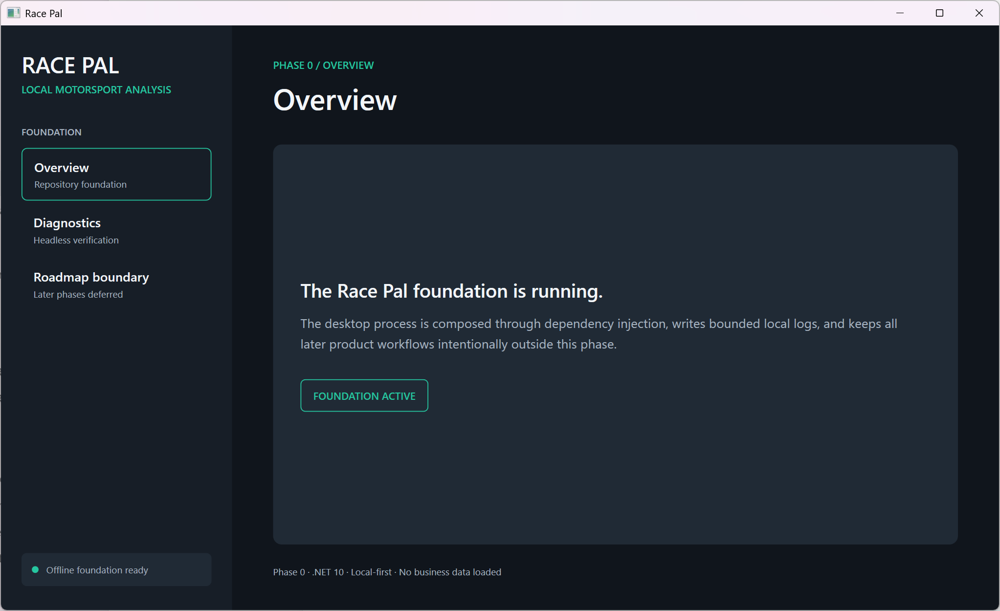
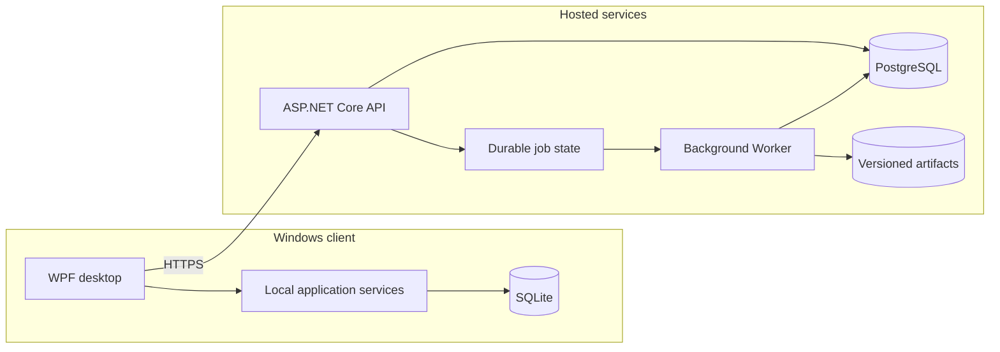

# RacePal

**Karting telemetry and performance intelligence, built around reproducible analysis and a server-authoritative architecture.**

RacePal is a pre-release software platform for importing motorsport session data, validating telemetry, and supporting deterministic performance analysis. It combines a native Windows client with a hosted .NET API, durable background processing, and distinct local and hosted storage layers.

This repository documents the product, module architecture, delivery practices, and engineering decisions. The application implementation is maintained privately: the public source tree contains module descriptions, not the proprietary C# implementation.

[Architecture](docs/02-ARCHITECTURE.md) · [Product scope](docs/01-PRODUCT-SCOPE.md) · [Development workflow](docs/03-ENGINEERING-WORKFLOW.md) · [Agentic development](docs/05-AGENTS-AND-AUTOMATION.md) · [Software architecture & AI-assisted development](docs/12-SOFTWARE-ARCHITECTURE-AND-AI-ASSISTED-DEVELOPMENT.md) · [Current status](docs/08-DELIVERY-STATUS.md)

## Desktop application — early development snapshot



*Historical screenshot (July 2026): the initial Windows Presentation Foundation (WPF) desktop shell during Phase 0. This illustrates the early navigation and application foundation, not the current feature set or deployment status. See [Development status](docs/08-DELIVERY-STATUS.md) for the staged implementation status.*

## System overview

The architecture follows a **modular monolith**, with explicit module responsibilities and a separation between the client and hosted trust boundaries. Local desktop capabilities coexist with an incremental transition to server-authoritative processing.



The diagram describes high-level component relationships. It intentionally omits private contracts, endpoint details, internal algorithms, and deployment topology.

## Capabilities

- **Desktop application:** C# / .NET 10 / Windows Presentation Foundation (WPF), with presentation separated from application logic.
- **Telemetry ingestion:** controlled import, validation, normalization, and defensive handling of untrusted files.
- **Deterministic analysis:** repeatable computations with explicit provenance and versioned artifacts.
- **Hosted application layer:** an ASP.NET Core API responsible for authenticated, organization-scoped operations.
- **Background execution:** a separate Worker and durable job state for processing that should not block an HTTP request.
- **Data persistence:** SQLite-backed local workflows and PostgreSQL-backed hosted services, with separate ownership boundaries.
- **Security:** OpenID Connect (OIDC), Proof Key for Code Exchange (PKCE), server-side authorization, and scoped resource access.

Capabilities are delivered in stages. The repository does not imply that every planned feature is implemented or publicly deployed; the [delivery status](docs/08-DELIVERY-STATUS.md) records those distinctions.

## Technology

| Component | Technologies and practices |
| --- | --- |
| Desktop | C#, .NET 10, WPF |
| API | ASP.NET Core, authenticated HTTPS interfaces |
| Background processing | .NET Worker, durable job execution |
| Data layer | Entity Framework Core, SQLite, PostgreSQL |
| Operational packaging | Docker Compose, reverse proxy, explicit migration sequencing |
| Testing and quality | xUnit, targeted/integration tests, architecture checks |
| Delivery and security | Git, GitHub, pull requests, GitHub Actions, CodeQL, dependency auditing |
| Engineering automation | Repository instructions, specialized agents, task approvals, automated verification |

## Architecture and engineering practices

RacePal development uses staged architectural decisions, documented scope and acceptance criteria, isolated Git branches, reviewable pull requests, and test/security gates. The process is designed to preserve traceability from product requirements to implementation and verification.

Engineering work is coordinated across the native UI, application services, APIs, asynchronous jobs, telemetry handling, persistence, infrastructure, and testing. AI-assisted implementation is governed by repository instructions and human approval boundaries rather than unrestricted autonomous changes.

Technical documentation:

- [System architecture](docs/02-ARCHITECTURE.md) — components, responsibilities, and trust boundaries.
- [Engineering workflow](docs/03-ENGINEERING-WORKFLOW.md) — planning, implementation, Git/GitHub, review, and verification.
- [Engineering ownership](docs/04-ENGINEERING-OWNERSHIP.md) — architectural and development responsibilities.
- [Software architecture & AI-assisted development](docs/12-SOFTWARE-ARCHITECTURE-AND-AI-ASSISTED-DEVELOPMENT.md) — architectural ownership, agent configuration, delegation, manual review, and controlled integration.
- [AI agents and automation](docs/05-AGENTS-AND-AUTOMATION.md) — specialized roles, controls, and delivery lifecycle.
- [Quality and security](docs/06-QUALITY-AND-SECURITY.md) — testing, Continuous Integration (CI), scanning, and threat-oriented design.
- [Architecture decisions](docs/07-ARCHITECTURE-DECISIONS.md) — selected decisions and rationale.
- [Operations and recovery](docs/09-OPERATIONS-AND-RECOVERY.md) — packaging, backups, and restore controls.
- [Engineering guidebook](docs/10-ENGINEERING-GUIDEBOOK.md) — documentation hierarchy and implementation lifecycle.
- [Development case study](docs/11-DEVELOPMENT-CASE-STUDY.md) — staged evolution from local workflows to hosted processing.

## Repository structure

```text
.github/     Repository governance, agent profiles, and documentation CI
src/         Public descriptions of application modules; no source code
tests/       Public descriptions of test projects; no test implementations
docs/        Product, architecture, engineering, operations, and status
samples/     Fictional data examples
scripts/     Public-content validation
```

The `src/` and `tests/` layouts mirror the major module and testing boundaries of the private engineering project at a descriptive level. This documentation repository is **not a runnable build**.

## Development status

RacePal is actively developed and remains **pre-release**. Native/local workflows, hosted service components, and automated verification exist in the private codebase. Alpha deployment packaging is present, but packaging and static checks are not equivalent to a completed live deployment or disaster-recovery acceptance. Simulation, optimization, and AI-related product ambitions have separate staged statuses.

The authoritative public capability summary is [Delivery Status](docs/08-DELIVERY-STATUS.md).

## License and security

RacePal is proprietary. This repository does not include the application's source code, production credentials, customer data, unpublished algorithms, or private Git history. All rights are reserved; see [LICENSE](LICENSE). Report sensitive security concerns privately using [SECURITY.md](SECURITY.md).
