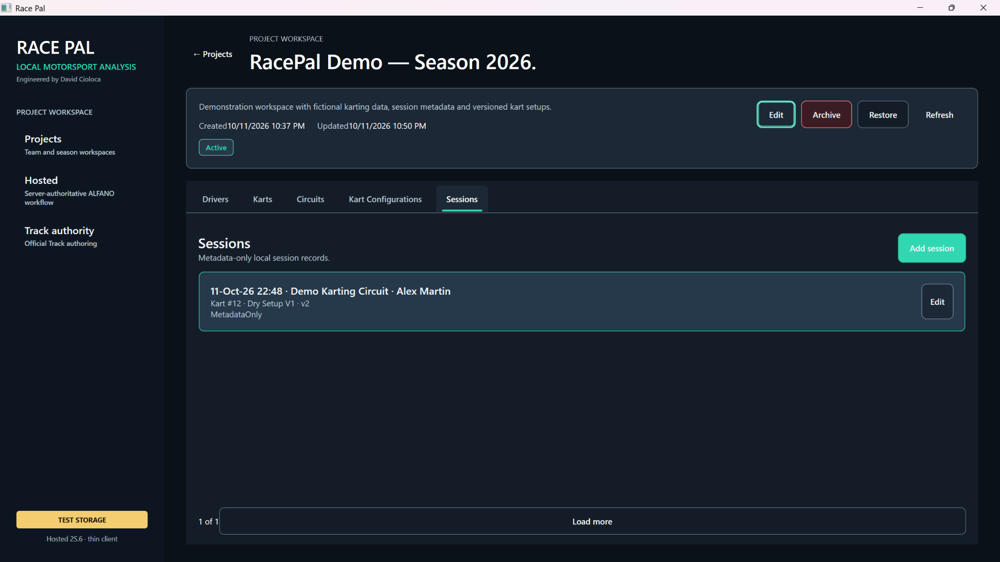
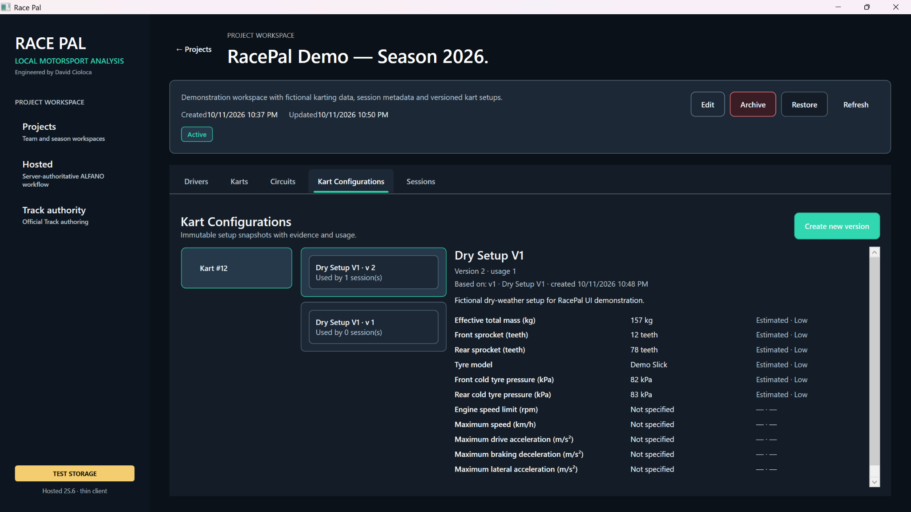
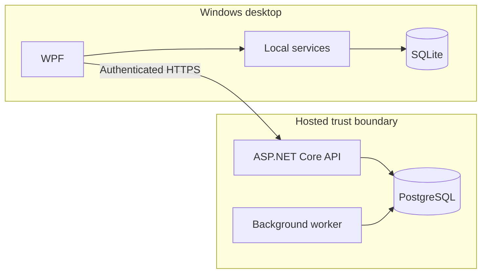

# RacePal

RacePal is a pre-release karting telemetry and performance-analysis platform. It combines a native Windows desktop application with staged hosted .NET services for ingestion and deterministic analysis.



*Actual WPF desktop application, October 2026, running against isolated TEST STORAGE with fictional data. This is a metadata-only session, not a processed telemetry result.*

## Engineering highlights

- **Local desktop:** a working .NET 10 WPF interface for drivers, karts, circuits, session metadata, and versioned setups.
- **Reviewable backend sample:** an independently authored ASP.NET Core API with parameterized PostgreSQL queries, 17 xUnit tests, and 2 PostgreSQL integration tests.
- **Security by design:** JWT validation, organization-scoped database access, documented trust boundaries, and CI secret scanning. The sample is not the proprietary RacePal server.

## At a glance

| Area | Technologies / approach |
| --- | --- |
| Windows client | C#, .NET 10, Windows Presentation Foundation (WPF), SQLite |
| Hosted backend | ASP.NET Core, PostgreSQL, background Worker |
| Engineering | Modular architecture, tests, GitHub Actions, code review |
| Security | OIDC/PKCE design, server-side tenant authorization, defensive input handling |

The platform is not a production release. Hosted components and analysis features have staged implementation and validation statuses; see [delivery status](docs/08-DELIVERY-STATUS.md).

## Code you can inspect

[**Standalone ASP.NET Core + PostgreSQL example**](examples/README.md) — a small, independently authored, runnable reference showing:

- JWT bearer authentication and authorization with a server-derived organization scope.
- A PostgreSQL repository using parameterized queries and async I/O.
- Request validation and xUnit unit tests, checked in CI.

This is **not copied from the private RacePal implementation**. It demonstrates engineering patterns, rather than revealing application internals or proving the full production stack. Run its unit tests with:

```bash
dotnet test examples/LapNotes.Tests/LapNotes.Tests.csproj -c Release
```

## Desktop walkthrough



*Immutable local kart setup snapshots with version history, one linked demo session, and synthetic values labeled `Estimated · Low`.*

[18 additional screenshots](assets/screenshots/showcase/README.md) · [Historical Phase 0 desktop](assets/screenshots/desktop-foundation-phase0.png)

## Architecture



This is a conceptual component diagram; the private repository contains the actual application implementation and deployment configuration.

## Security and verification

The [security overview and threat model](docs/14-EXAMPLE-THREAT-MODEL.md) explains authentication, trust boundaries, tenant isolation, credentials, and untrusted-input handling, while distinguishing the illustrative API from RacePal's private architecture. Public CI checks the example's .NET tests and scans for likely secrets. Automated checks are not a substitute for manual review.

## Engineering and development history

The project developer owns architectural decisions, module boundaries, sequencing, reviews and integration. Specialized AI-assisted tooling has supported bounded implementation and verification tasks under human approval.

- [System architecture](docs/02-ARCHITECTURE.md)
- [Engineering ownership](docs/04-ENGINEERING-OWNERSHIP.md)
- [Development workflow](docs/03-ENGINEERING-WORKFLOW.md)
- [GitHub repository workflow and CI configuration](.github/WORKFLOW.md)
- [Software architecture and AI-assisted development](docs/12-SOFTWARE-ARCHITECTURE-AND-AI-ASSISTED-DEVELOPMENT.md)
- [Architecture decisions](docs/07-ARCHITECTURE-DECISIONS.md)
- [Quality and security](docs/06-QUALITY-AND-SECURITY.md)
- [Product scope](docs/01-PRODUCT-SCOPE.md)
- [Public delivery status](docs/08-DELIVERY-STATUS.md)

The [module map](src/README.md) and [test project map](tests/README.md) are descriptive: they contain no proprietary implementation. The only executable C# in this public repository is the clearly separated `examples/` reference.

## License and contact

RacePal remains proprietary and pre-release. Public accessibility does not authorize reuse of proprietary material; see [LICENSE](LICENSE). Please disclose security concerns privately according to [SECURITY.md](SECURITY.md).
