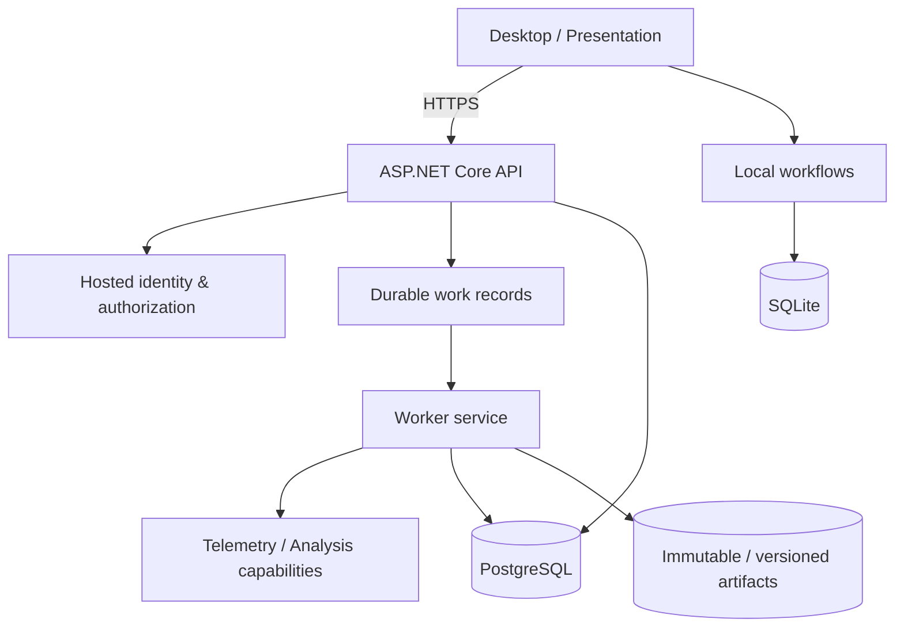
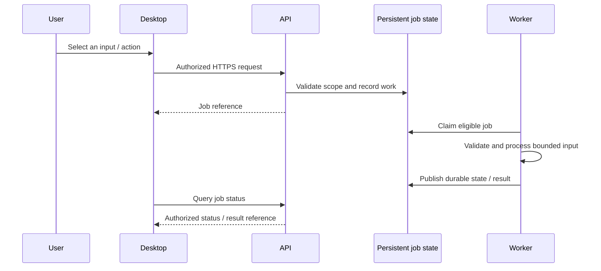

# 02 — System architecture

## Architectural style

**Modular monolith with clear technical and domain boundaries.** The backend has separately hosted API and Worker processes but a common application/business core. It is not presented as independent microservices.

## Responsibilities

| Boundary | Responsibility | Separation rule |
| --- | --- | --- |
| Desktop | Windows UI, view state, user interactions | Does not own hosted authorization or trusted computation |
| Client contracts | Request/response and user-facing abstractions | Avoids server infrastructure dependencies |
| API | Authenticate, authorize, validate, accept and query work | Avoids lengthy telemetry computations inside handlers |
| Application / Domain | Business use cases, rules, invariants | Should not depend on WPF or a specific database provider |
| Worker | Durable asynchronous processing and artifact publishing | Operates on validated jobs and bounded input |
| Infrastructure | SQL/persistence, filesystem, technical adapters | Hidden behind defined contracts |
| Telemetry / Analysis | External input handling and reproducible derivations | Remain testable independently of UI |

## Request lifecycle (illustrative)

This sequence is a **simplified conceptual representation**, not a published wire protocol or an assertion about every individual endpoint.

## Central design choices

1. **Thin client / hosted authority:** inspectable client inputs cannot decide permissions or entitlement state.
2. **Durable jobs:** CPU/file work should not be coupled to a single HTTP request lifetime.
3. **Versioned artifacts:** reproducible results require identities and compatibility strategies.
4. **Two persistence contexts:** a local workflow uses SQLite; hosted data uses PostgreSQL with dedicated authorization and lifecycle controls.
5. **Architecture tests and ADRs:** dependency direction and major decisions become verifiable maintenance boundaries.

## Trade-offs

A modular monolith reduces distribution and operational complexity but requires disciplined boundaries. Supporting both local history and hosted ownership introduces migration and coexistence work. WPF provides a native Windows client rather than a browser SPA; thus "full-stack" here means desktop client + API + Worker + persistence + operations, **not** a React/Vue/Angular frontend.
