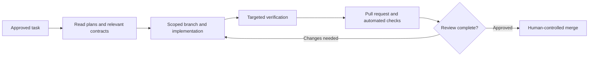

# 05 — AI agents and engineering automation

## Operating model

RacePal adopts **human-directed, AI-assisted software engineering**. The development workflow uses repository-level instructions to constrain planning, implementation, testing, and security review. Agents execute defined work; product direction, system architecture, merge decisions, privileged changes, and deployment authority remain with the project owner.

## Specialized roles

| Agent | Responsibility | Boundary |
| --- | --- | --- |
| Architect / Planner | Decompose objectives into verifiable tasks and identify architectural trade-offs | No unilateral architecture changes or production code edits |
| Implementer | Deliver one approved change with tests and verification evidence | No unauthorized merges, deployments, or scope expansion |
| Test Engineer | Reproduce failures and strengthen regression coverage | No skipped tests or reduced assertions without verified justification |
| Security Reviewer | Examine authorization, tenancy, input handling, secrets, and dependencies | Findings and recommendations, not unilateral policy exceptions |

The [`.github/agents/`](../.github/agents/) directory contains sanitized public profiles. They describe agent roles and controls; availability or invocation depends on the configured tooling and permissions.

## Task contract

Each task includes a defined objective, acceptance criteria, non-goals, affected modules, dependencies, risk category, validation requirements, and approval. Changes are isolated in branches and reviewed through pull requests. Overlapping writes to architectural contracts or database migrations are scheduled conservatively.

## Decision gates

Agents must request a human decision before changing architecture, authorization, tenant isolation, persisted formats, irreversible migrations, authoritative numerical behavior, paid provider dependencies, production infrastructure, secrets, or repository access.

```text
DECISION REQUIRED: <topic>
```

The response includes alternatives, trade-offs, a recommendation, and the precise change awaiting approval.

## Repository automation

The private engineering repository defines and uses GitHub Actions for .NET verification, Windows checks, Linux PostgreSQL integration, CodeQL analysis, dependency auditing, and supply-chain controls. It also contains issue/PR templates and review rules used to track engineering work.

Additional scheduling and agent-orchestration experiments have been scoped separately. Their existence does not imply unattended continuous development or that all agent workflows are currently enabled.

## Change lifecycle



This model uses automation to accelerate bounded implementation work while keeping traceability, testing, architectural consistency, and release accountability intact.

For the architect's responsibilities, Codex and agent configuration, task delegation, manual verification, and concrete engineering examples, see [Software architecture and AI-assisted development](12-SOFTWARE-ARCHITECTURE-AND-AI-ASSISTED-DEVELOPMENT.md).
