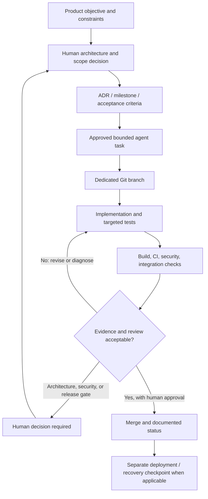

# 12 — Software Architecture and AI-Assisted Development

**Technical ownership, controlled delegation, and evidence-driven delivery**

## 1. Engineering approach

RacePal is developed under a **human-directed, AI-assisted engineering model**. The project owner acts as **Software Architect and Engineering Lead**, retaining responsibility for product direction, system design, work breakdown, acceptance criteria, architecture decisions, code integration, security-sensitive changes, and release authorization.

AI coding assistants contribute to implementation, analysis, test design, and review within those boundaries. They are engineering tools and delegated contributors, **not** the source of architectural authority. A completed agent task is a candidate change: it becomes accepted engineering work only after the relevant tests, automated checks, review, and human decision gates have been satisfied.

This distinction is fundamental to the development process:

> The project owner defines **what the system must do, why it must work that way, where its boundaries lie, and how correctness will be demonstrated**. AI tools may help propose or implement **how a bounded change is delivered**.

The workflow is based on repository-maintained policies rather than a single large prompt. The private engineering repository includes a product charter, architecture specifications, Architecture Decision Records (ADRs), execution plans, Codex prompts, specialized agent profiles, coding rules, code-review criteria, issue and pull-request templates, and automated verification workflows. This public repository presents their architecture and operating principles without publishing proprietary implementation code.

## 2. Responsibilities retained by the software architect

The owner's role spans architectural decisions and practical software delivery; it is not limited to requesting generated source code.

| Responsibility | Architectural and engineering work |
| --- | --- |
| Product and requirements | Define user needs, product invariants, staged scope, priorities, acceptance criteria, and explicit exclusions. |
| System design | Select component boundaries, dependency directions, data flows, trust boundaries, and integration strategies. |
| Technology decisions | Establish the C# / .NET foundation, Windows Presentation Foundation (WPF) client, ASP.NET Core hosted services, persistence choices, and verification approach. |
| Client/server separation | Keep server-authoritative state and protected capabilities behind a hosted boundary while preserving valid local workflows during migration. |
| Data and computation | Define ownership of SQLite versus PostgreSQL persistence, durable jobs, versioned artifacts, and reproducible telemetry/analysis results. |
| Change planning | Break milestones into coherent, reviewable increments with dependencies, risks, non-goals, and acceptance criteria. |
| Agent orchestration | Write the operating instructions, configure specialized roles, select delegable tasks, and prevent overlapping or unauthorized work. |
| Technical verification | Evaluate architecture consistency, diff scope, test coverage, CI results, failure causes, security implications, and compatibility concerns. |
| Release and operations | Retain approval for merges, migrations, external dependencies, deployment steps, backups, and recovery decisions. |

These responsibilities describe technical leadership of the project. They do not imply that every source line was personally typed, that AI output was accepted without inspection, or that a separate enterprise engineering team was involved.

## 3. Architecture defined before implementation

The project began with an architecture-first development process: document the product, select component responsibilities, establish dependency constraints, and decompose the roadmap before asking coding tools to deliver a complete application.

### 3.1 Core decisions

Several design choices shaped subsequent implementation:

- **Modular monolith, not prematurely distributed microservices.** Functional areas are separated through explicit .NET project and contract boundaries, while the hosted API and Worker share the business core.
- **Thin client and server authority.** The installed Windows application is inspectable and cannot be trusted to enforce hosted authorization, tenant separation, entitlements, quotas, or integrity of authoritative results.
- **Distinct execution concerns.** The API handles bounded requests and resource operations; long-running processing belongs to durable background jobs and Worker execution.
- **Persistence by responsibility.** SQLite supports the local application path; PostgreSQL supports organization-scoped hosted state. Large telemetry sample streams are represented as bounded, versioned artifacts rather than indiscriminately materialized into database rows.
- **Domain and computation independence.** Business rules and deterministic numerical processing should not depend on WPF view code, HTTP endpoints, or a particular persistence provider.
- **Incremental migration.** Existing tested desktop behavior is not discarded by a large rewrite; authority and dependencies move through separately reviewed and verified transitions.
- **Evidence before claims.** Implemented, packaged, planned, and deferred capabilities are distinguished so that design intent is not mistaken for delivered functionality.

The accepted architecture is described in [System architecture](02-ARCHITECTURE.md), with selected rationales in [Architecture decisions](07-ARCHITECTURE-DECISIONS.md).

### 3.2 Architecture Decision Records

Material technical choices are documented using **Architecture Decision Records (ADRs)**: context, alternatives, constraints, selected direction, trade-offs, and implementation consequences. Significant changes are not made simply because an assistant suggests a shorter path.

Examples of decisions managed through this approach include separating desktop-specific infrastructure from server authority, planning persistence ownership transitions, preserving schema and data compatibility, and establishing a deterministic, reusable telemetry-processing boundary.

An ADR may approve a design or a limited foundation without authorizing its entire rollout. **Design approved** and **migration completed** are different states.

## 4. Preparing the engineering environment and the guidebook

AI-assisted work starts from a controlled repository context, not from an empty conversation. The private engineering project has used:

| Repository artifact | Function |
| --- | --- |
| `PRODUCT.md` | Product charter, scope boundaries, design principles, and capability status vocabulary. |
| `AGENTS.md` | Shared engineering instructions, hard constraints, and definition of done for coding agents. |
| `PLANS.md` | Phase-based execution planning, decisions, progress, and acceptance context. |
| `CODE_REVIEW.md` | Repeatable review criteria for architecture, correctness, telemetry safety, and quality. |
| `prompts/CODEX-MASTER-PROMPT.md` | Initial audit-first instructions for Codex; verify prerequisites and prepare the first bounded plan before implementation. |
| `prompts/PHASE-PROMPTS.md` | Phase-specific prompts with narrow goals, prerequisites, tests, and exclusions. |
| `.github/copilot-instructions.md` | Repository-wide engineering conventions for GitHub Copilot-assisted work. |
| `.github/agents/` | Specialized Architect, Implementer, Security Reviewer, and Test Engineer agent definitions. |
| `.github/instructions/` | Additional rules scoped to affected components or technical domains. |
| `.github/ISSUE_TEMPLATE/` | Structured task authorization and escalation of human decisions. |
| `.github/pull_request_template.md` | Change risk, review checklist, tests, validation evidence, and rollback information. |
| `.github/workflows/` | Continuous Integration (CI), security analysis, and dependency/supply-chain automation. |

The public `AGENTS.md` and `.github/agents/` files are **sanitized, documentation-only counterparts**. They intentionally do not grant access to the private implementation. The original engineering configurations remain in the private repository.

### 4.1 Initial Codex workflow

The Codex master instructions explicitly begin with **reading the documentation and auditing the repository**, not generating the full product at once. The first bounded outcome is an implementation-readiness report and plan. Code changes are permitted only after the relevant plan has been accepted.

Subsequent phase prompts establish scope: implement one phase, avoid unrelated modules and unauthorized technology changes, add tests, execute the prescribed checks, and report limitations. This prevents the assistant from treating a broad roadmap as permission for an uncontrolled rewrite.

### 4.2 Specialized roles

The GitHub agent configuration separates responsibilities instead of giving one agent unrestricted ownership of the entire lifecycle:

| Agent role | Delegated responsibility | Restricted authority |
| --- | --- | --- |
| **Architect / Planner** | Inspect existing context; propose bounded implementation tasks, dependencies, trade-offs, risks, and verification plans. | May not unilaterally redefine architecture, implement product code as part of planning, or authorize a gated decision. |
| **Implementer** | Make the smallest approved product change, add or update tests, and produce a reviewable branch/PR with evidence. | May not change scope, bypass checks, merge, deploy, or modify protected settings. |
| **Test Engineer** | Diagnose regression and nondeterministic failures, identify root causes, and strengthen deterministic test coverage. | May not delete failing tests, conceal races with arbitrary delays, or weaken assertions merely to obtain green results. |
| **Security Reviewer** | Review authentication, authorization, tenant boundaries, untrusted inputs, sensitive data, supply chain, and deployment risks. | Conducts review and reports findings; does not approve its own exceptions or silently alter security policy. |

These definitions describe **configured responsibilities and governing rules**. They are not a claim that all four agents were simultaneously running continuously or that every proposed cloud-agent workflow was enabled at all times.

## 5. Task decomposition and controlled delegation

Development objectives are decomposed into **bounded units of work** before assigning them to an AI contributor. The architect decides both what is safe to delegate and what must remain a human decision.

A work item specifies:

1. **Objective and value:** the observable problem to solve.
2. **Scope and non-goals:** affected subsystem and explicitly excluded changes.
3. **Architectural context:** relevant contracts, approved decisions, dependencies, and trust boundaries.
4. **Acceptance criteria:** testable conditions for completion.
5. **Risk classification:** low, medium, or high depending on behavioral, data, security, or operational impact.
6. **Verification requirements:** unit, integration, architecture, security, compatibility, and platform checks as applicable.
7. **Approval:** explicit human authorization for the bounded task; additional gates still require separate approval.

The private project includes a structured **Agent task** issue template with these fields and an explicit approval checkbox. A typical task maps to one isolated branch and one pull request (PR). Related work is sequenced; concurrent agents are not assigned conflicting writes to the same central contracts, migrations, or architectural policy.

### What can be delegated

Within approved limits, suitable work includes narrow feature implementation, adapter changes, unit and integration tests, failure reproduction, static-analysis remediation, documentation synchronization, dependency maintenance, and verification-oriented refactoring.

### What remains a human decision

Agent authority stops at changes to system architecture, authentication and authorization semantics, tenant isolation, irreversible schema changes, persisted-format compatibility, numerical correctness contracts, new providers or recurring costs, deployment, credentials, and access control. The agent must report:

```text
DECISION REQUIRED: <topic>
```

The report describes options, trade-offs, a recommendation, and exactly what is blocked. It does **not** constitute approval. A green build does not waive these decision gates.

## 6. End-to-end delivery lifecycle



### 6.1 Before code changes

The owner or planning agent reads product scope, applicable ADRs, existing code contracts, test coverage, and the current Git/PR state. The task is checked for hidden dependencies, unintended architectural changes, and possible overlap with another workstream.

### 6.2 During implementation

An implementer works on a scoped branch, follows repository coding rules, avoids unrelated refactors, and produces tests with the change. Documentation and acceptance criteria are updated only as required by the approved scope. Problems outside the scope are escalated rather than silently absorbed into the PR.

### 6.3 Automated verification

The private engineering repository contains an established verification setup, including:

- **Release build, automated tests, and formatting checks** for .NET changes.
- **Architecture and dependency checks** to detect unwanted coupling across modules.
- **Windows verification** for the desktop-specific application environment.
- **Linux integration testing with PostgreSQL** for hosted persistence behavior.
- **CodeQL static security analysis** and vulnerability/dependency audits.
- **GitHub Actions workflows** associated with the pull-request lifecycle.

These controls are executed according to task risk and available environments. A workflow's presence does not mean every run is green or that an unexecuted live-deployment test has been completed.

### 6.4 Human review and acceptance

Review focuses on **behavior and architecture, not just whether code compiles**. Before accepting a significant change, the owner examines the change summary and diff, dependencies, user-visible effects, changed security assumptions, test evidence, unresolved warnings, compatibility implications, and any required rollback plan.

A PR that changes a schema, authority boundary, or persistence lifecycle demands stronger evidence than a documentation-only edit. A passing automated job is necessary where required, but not sufficient to justify an unauthorized merge.

## 7. What is manually checked

The owner retains responsibility for the following categories of review:

| Review dimension | Questions used during acceptance |
| --- | --- |
| Requirements | Does the change satisfy the approved acceptance criteria without silently expanding scope? |
| Architecture | Are dependency directions, component ownership, and client/server trust boundaries preserved? |
| Source diff | Are changes localized? Is there generated code that adds needless complexity, duplicates logic, or hides unintended effects? |
| Correctness | Are failure paths, cancellation, concurrency, units, deterministic results, and edge cases covered appropriately? |
| Persistence | Are migrations explicit? Could writes, retries, schema changes, or recovery actions damage existing state? |
| Security | Are authorization and tenant checks server-side? Are untrusted inputs bounded and secrets kept out of source and logs? |
| Verification | What tests and commands actually ran? Which failed, passed, or were unavailable, and why? |
| Git/CI | Is the branch limited in scope? Are PR comments, relevant checks, and decision gates resolved? |
| Operations | Where relevant, is sequencing, backup validation, rollback, and deployment readiness documented? |

Manual oversight does not imply re-implementing the agent's code line by line. It means **retaining responsibility for architectural fit, evidence, risk, and the final decision**.

## 8. Engineering examples

The examples below describe **types of work evidenced in the private development history**, summarized at a non-sensitive level. They do not disclose internal algorithms or proprietary code.

### Example A — Incremental client/server boundary evolution

**Problem:** A desktop-first implementation needed to support hosted capabilities without moving protected business authority into the installed client or risking an unverified all-at-once rewrite.

**Architectural direction:** Establish explicit client contracts, hosted API and Worker responsibilities, independent hosted persistence, and separate local lifecycle ownership. Preserve working local capabilities while moving well-defined responsibilities through small checkpoints.

**Delegable implementation:** Contract scaffolding, adapters, narrowly scoped persistence refactors, regression tests, and documentation updates.

**Human-controlled evaluation:** Confirm dependency boundaries, preservation of legacy data and startup behavior, hosted authorization responsibilities, and readiness for any authority transfer. An approved migration design is not equivalent to completed migration.

**Engineering value:** Reduces coupling and migration risk while enabling incremental verification.

### Example B — Diagnosing an automated Windows regression

**Problem:** Repository verification identified a nondeterministic concurrency failure involving an internal migration-recovery marker.

**Technical response:** The issue was treated as a race/root-cause investigation rather than as a reason to skip or relax a failing test. A bounded concurrency fix and regression-oriented verification were tracked through the repository workflow.

**Owner's acceptance responsibility:** Validate that the proposed fix preserves migration and recovery semantics, does not introduce wider lifecycle changes, and provides evidence against the original failure mode.

**Engineering value:** Treats CI failures as product and reliability evidence rather than obstacles to bypass.

### Example C — Security and supply-chain hardening

**Problem:** The hosted boundary requires security checks beyond the ordinary .NET build, including detection of unsafe logging patterns, dependency risk, and potential authorization mistakes.

**Technical response:** Repository work introduced CodeQL and dependency-auditing workflows; tracked security findings were addressed with targeted fixes and review. Supply-chain checks were made part of ongoing engineering rather than an end-of-project step.

**Owner's acceptance responsibility:** Inspect risk severity, the actual change and its limitations, validation evidence, and whether a security decision requires explicit approval.

**Engineering value:** Security controls are integrated into normal version-controlled delivery.

## 9. Version control, automation, and operational discipline

Git and GitHub provide the change history and review surface: dedicated branches, coherent commits, issue references, PR descriptions, risk classifications, review discussions, and checks. Automation accelerates repeatable work, but **merge and production authority are separated from code generation**.

Operational planning is a distinct engineering track. RacePal includes alpha deployment packaging and tooling for backup validation, guarded restore, migration sequencing, and readiness checks in the private implementation. The architect treats recovery, data integrity, and rollback as design constraints early in a change. These controls must not be confused with evidence that a live production restore drill or hosted launch has already passed.

The same principle applies to autonomous development: specialized agents, instructions, and GitHub Actions are repository assets; unattended scheduling and full end-to-end agent orchestration have their own availability, approval, and operational constraints.

## 10. Status, limitations, and technical accountability

RacePal remains a **pre-release application**. The implementation repository contains native and hosted components and an engineering workflow with documented agents, Git/CI controls, and review practices. Some future hosted operations, agent scheduling scenarios, simulation/optimization capabilities, and AI-driven product functions are staged work. They should not be represented as continuously running or production-validated merely because they are documented.

AI-assisted engineering also introduces specific review burdens: generated changes can be plausible but incorrect; tests can miss assumptions; agents can misunderstand business requirements or expand scope; and automation cannot assume architectural authority. RacePal's operating model addresses these risks through scoped tasks, documented constraints, deterministic verification where possible, security review, and human-controlled integration.

**Accountability remains with the software architect and project owner:** selecting the architecture, authorizing work, reviewing the evidence, deciding when changes are acceptable, and declining changes when their correctness or safety is not sufficiently demonstrated.

## 11. Related public documentation

- [Engineering ownership](04-ENGINEERING-OWNERSHIP.md) — overall technical responsibility.
- [Engineering workflow](03-ENGINEERING-WORKFLOW.md) — Git, planning, review, and verification lifecycle.
- [AI agents and automation](05-AGENTS-AND-AUTOMATION.md) — specialized agent responsibilities and hard boundaries.
- [Engineering guidebook](10-ENGINEERING-GUIDEBOOK.md) — documentation hierarchy and development process.
- [System architecture](02-ARCHITECTURE.md) — components and trust boundaries.
- [Quality and security](06-QUALITY-AND-SECURITY.md) — automated and manual verification.
- [Operations and recovery](09-OPERATIONS-AND-RECOVERY.md) — release packaging and recoverability controls.
- [Delivery status](08-DELIVERY-STATUS.md) — current capability maturity.
- [Public agent definitions](../.github/agents/) and [agent instructions](../AGENTS.md) — sanitized documentation-repository policies.
